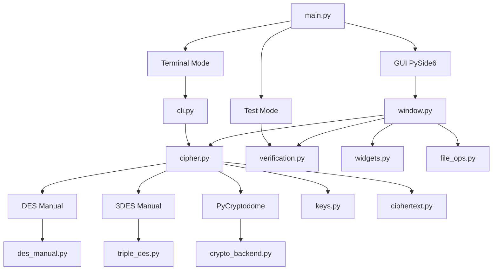

<div align="center">
  

# 🔐 ZarCryptoDES

### DES & Triple DES Learning Suite — Manual vs Library

**Aplikasi desktop Python untuk mempelajari, menguji, membandingkan, dan memvisualisasikan proses enkripsi DES dan 3DES.**


</div>

---

## 📖 Tentang Proyek

**ZarCryptoDES** adalah aplikasi pembelajaran kriptografi berbasis Python yang mengimplementasikan **DES (Data Encryption Standard)** dan **Triple DES / 3DES** melalui dua pendekatan:

- 🧠 **Implementasi manual** — proses DES dibuat dari logika algoritma sendiri, termasuk pembentukan subkey, permutasi, S-Box, Feistel, ECB, CBC, dan 3DES-EDE.
- ⚙️ **Implementasi library** — menggunakan **PyCryptodome** sebagai pembanding hasil enkripsi/dekripsi.

Aplikasi ini tidak hanya melakukan enkripsi dan dekripsi. ZarCryptoDES juga menyediakan pengujian otomatis, perbandingan manual vs library, visualisasi ronde Feistel, pengelolaan kunci, pemrosesan file, dan antarmuka desktop menggunakan **PySide6**.

> [!IMPORTANT]
> **DES dan 3DES merupakan algoritma lama dan tidak direkomendasikan untuk sistem keamanan modern.** Proyek ini dibuat untuk kebutuhan **pembelajaran, praktikum, demonstrasi algoritma, dan analisis kriptografi**.

---

## ✨ Fitur Utama

| Fitur | Deskripsi |
|---|---|
| 🔐 **DES Manual** | Implementasi DES dari proses permutasi hingga 16 ronde Feistel tanpa memakai DES library untuk inti algoritmanya. |
| 🔐 **Triple DES Manual** | Implementasi 3DES dengan skema **EDE (Encrypt–Decrypt–Encrypt)** menggunakan mesin DES manual. |
| 📚 **PyCryptodome Backend** | Pembanding implementasi manual menggunakan `Crypto.Cipher.DES` dan `Crypto.Cipher.DES3`. |
| 📄 **Enkripsi File** | Mengenkripsi data/file teks dan menyimpan ciphertext. |
| 🔓 **Dekripsi File** | Mengembalikan ciphertext menjadi plaintext menggunakan kunci yang sesuai. |
| 🔁 **ECB & CBC** | Mendukung pemrosesan blok dalam mode ECB dan CBC. |
| 🧱 **PKCS#7 Padding** | Menyesuaikan panjang plaintext agar sesuai dengan blok DES 8 byte. |
| 🔑 **HEX & UTF-8 Key** | Kunci dapat dimasukkan sebagai HEX maupun teks biasa UTF-8. |
| 🎲 **Key Generator** | Mendukung pembuatan kunci 3DES acak yang tervalidasi. |
| 🧪 **Automated Verification** | Menguji hasil manual terhadap PyCryptodome, test vector, padding, file, dan input tidak valid. |
| ⚖️ **Manual vs Library** | Membandingkan ciphertext dan melakukan cross-decryption antara dua implementasi. |
| 🌀 **Jejak Feistel** | Menampilkan detail 16 ronde DES beserta `L`, `R`, subkey, fungsi `F`, dan operasi XOR. |
| 🧾 **Riwayat Sesi** | Menyimpan aktivitas selama aplikasi berjalan tanpa menyimpan plaintext atau kunci di history. |
| 🖥️ **GUI Desktop** | Antarmuka modern menggunakan PySide6 dengan sidebar, halaman pengujian, comparison, dan round trace. |
| ⌨️ **Terminal Mode** | Menjalankan proses enkripsi/dekripsi dari terminal tanpa membuka GUI. |

---

## 🧠 Konsep Kriptografi yang Diimplementasikan

### DES

DES memproses blok berukuran **64-bit / 8 byte** dengan kunci masukan **8 byte**. Proses utamanya mencakup:

1. Initial Permutation (`IP`)
2. Pembentukan 16 subkey melalui `PC-1`, shift, dan `PC-2`
3. 16 ronde jaringan Feistel
4. Expansion permutation (`E`)
5. XOR dengan round key
6. Substitusi menggunakan 8 S-Box
7. Permutasi `P`
8. Pertukaran blok kiri dan kanan
9. Final Permutation (`FP`)

### Triple DES / 3DES

Implementasi manual menggunakan skema **EDE**:

```text
Ciphertext = E(K3, D(K2, E(K1, Plaintext)))
```

Program menerima:

- **16-byte key** → 2-key 3DES (`K3 = K1`)
- **24-byte key** → 3-key 3DES

### CBC

Pada mode CBC, setiap blok plaintext di-XOR dengan ciphertext blok sebelumnya. Blok pertama menggunakan **Initialization Vector (IV)** berukuran 8 byte.

```text
P1 ── XOR IV ──> DES ──> C1
P2 ── XOR C1 ──> DES ──> C2
P3 ── XOR C2 ──> DES ──> C3
```

---

## 🏗️ Arsitektur Program



---

## 📂 Struktur Folder

```text
ZarCryptoDES/
│
├── main.py                # Entry point aplikasi
├── cli.py                 # Mode terminal
├── constants.py           # Tabel permutasi, S-Box, dan konstanta DES
├── crypto_backend.py      # Wrapper/import PyCryptodome
│
├── des_manual.py          # Implementasi DES manual
├── triple_des.py          # Implementasi 3DES manual EDE
├── feistel.py             # Simulasi Feistel sederhana
├── cipher.py              # Enkripsi/dekripsi, ECB, CBC, padding
├── keys.py                # Parsing, validasi, dan generator kunci
│
├── ciphertext.py          # Serialisasi & parsing ciphertext
├── file_ops.py            # Pemrosesan file
├── verification.py        # Pengujian dan pembandingan hasil
│
├── window.py              # Window utama GUI
├── widgets.py             # Widget dan komponen visual
├── theme.py               # Tema/style aplikasi
├── worker.py              # Background worker GUI
├── qt_compat.py           # Kompatibilitas/import PySide6
├── assets.py              # Asset/logo aplikasi
│
├── requirements.txt       # Dependency Python
├── README.md              # Dokumentasi proyek
└── docs/
    └── logo.png           # Logo README
```

> Folder `__pycache__/` tidak perlu di-upload ke GitHub.

---

## ⚙️ Instalasi

### 1. Clone repository

```bash
git clone <URL-REPOSITORY-KALIAN>
cd ZarCryptoDES
```

### 2. Opsional — buat virtual environment

**Windows PowerShell:**

```powershell
python -m venv .venv
.\.venv\Scripts\Activate.ps1
```

### 3. Install dependency

```bash
python -m pip install -r requirements.txt
```

Dependency utama:

```text
PySide6-Essentials
pycryptodome
```

---

## 🚀 Menjalankan Program

### GUI Mode

```bash
python main.py
```

GUI menyediakan halaman:

- 🏠 Beranda
- 🔐 Enkripsi File
- 🔓 Dekripsi File
- 🧪 Uji DES / 3DES
- ⚖️ Perbandingan
- 🌀 Jejak Feistel
- 🧾 Riwayat

### Terminal Mode

```bash
python main.py --terminal
```

Mode terminal memungkinkan pemilihan:

- DES / 3DES
- HEX / Text key
- format `zar`, `cbc`, atau `ecb`
- file masukan dan file keluaran

### Test / Verification Mode

```bash
python main.py --test
```

Mode ini menjalankan pengujian implementasi manual dan library serta menampilkan hasil ke terminal.

---

## 🔑 Format Kunci

### DES

DES membutuhkan **8 byte**.

Contoh HEX:

```text
133457799BBCDFF1
```

Contoh teks 8-byte:

```text
cerdas00
```

### 3DES

3DES menerima **16 atau 24 byte**.

Contoh 24-byte HEX:

```text
0123456789ABCDEFFEDCBA98765432100011223344556677
```

Program memvalidasi panjang kunci dan menolak kunci 3DES yang secara efektif menyusut menjadi DES tunggal.

---

## 🧪 Verification & Comparison

`verification.py` digunakan untuk memastikan implementasi manual bekerja konsisten dengan implementasi library.

Beberapa pemeriksaan yang dilakukan:

- DES known test vectors
- Enkripsi/dekripsi blok manual
- Perbandingan dengan PyCryptodome
- Pengujian pasangan data pseudorandom
- Validasi PKCS#7 padding
- Enkripsi/dekripsi CBC
- Cross-decryption manual ↔ library
- Pemrosesan file sementara
- Validasi input yang salah
- Pengujian DES dan 3DES
- Simulasi Feistel

Tujuannya adalah memastikan **hasil algoritma manual dapat diverifikasi**, bukan hanya menghasilkan ciphertext tanpa pembuktian.

---

## 🔄 Alur Enkripsi

```text
Plaintext / File
      │
      ▼
Validasi Kunci
      │
      ▼
PKCS#7 Padding
      │
      ▼
Pilih DES / 3DES
      │
      ├───────────────┐
      ▼               ▼
Manual Backend   Library Backend
      │               │
      └───────┬───────┘
              ▼
          ECB / CBC
              │
              ▼
         Ciphertext
              │
              ▼
        Simpan ke File
```

---

## 👥 Pembagian Kontribusi Tim

### 👨‍💻 Andika — Cryptography Core & Verification

Fokus pada algoritma inti, pengelolaan kunci, dan pembuktian hasil.

- `constants.py`
- `crypto_backend.py`
- `keys.py`
- `des_manual.py`
- `triple_des.py`
- `cipher.py`
- `feistel.py`
- `verification.py`
- `requirements.txt`
- `README.md`
- `docs/logo.png`
- `.gitignore`

### 👨‍💻 Rafael — Application, File I/O & GUI

Fokus pada aplikasi, format data, proses file, dan antarmuka pengguna.

- `main.py`
- `cli.py`
- `ciphertext.py`
- `file_ops.py`
- `qt_compat.py`
- `theme.py`
- `widgets.py`
- `window.py`
- `worker.py`
- `assets.py`

---

## 🤝 Workflow Kolaborasi GitHub

Workflow yang direkomendasikan:

```text
Andika
  │
  ├─ membuat repository
  ├─ push Cryptography Core
  ▼
GitHub Repository
  ▲
  │
Rafael
  ├─ clone repository
  ├─ membuat branch kontribusi
  ├─ menambahkan Application + GUI
  ├─ push branch
  └─ Pull Request → Merge
```

Dengan cara ini, **riwayat commit GitHub menunjukkan kontribusi masing-masing anggota secara jelas**.

---

## 🛡️ Catatan Keamanan

Proyek ini memperlihatkan bagaimana DES/3DES bekerja secara internal, tetapi **jangan gunakan DES atau 3DES untuk melindungi data sensitif pada aplikasi produksi baru**.

Untuk aplikasi modern, pertimbangkan algoritma seperti **AES** dengan mode authenticated encryption yang sesuai.

---

## 🎯 Tujuan Pembelajaran

Setelah mempelajari project ini, pengguna diharapkan dapat memahami:

- Struktur dasar block cipher
- Cara kerja jaringan Feistel
- Key schedule DES
- Peran permutation dan S-Box
- Perbedaan DES dan Triple DES
- Perbedaan ECB dan CBC
- Fungsi IV dan padding
- Perbedaan implementasi manual dan library
- Cara memverifikasi algoritma kriptografi dengan reference implementation
- Cara membangun GUI kriptografi modular menggunakan Python

---

<div align="center">

### 🔐 ZarCryptoDES
**Learn the cipher. Trace the rounds. Verify the result.**

Made for cryptography learning & experimentation.

</div>
